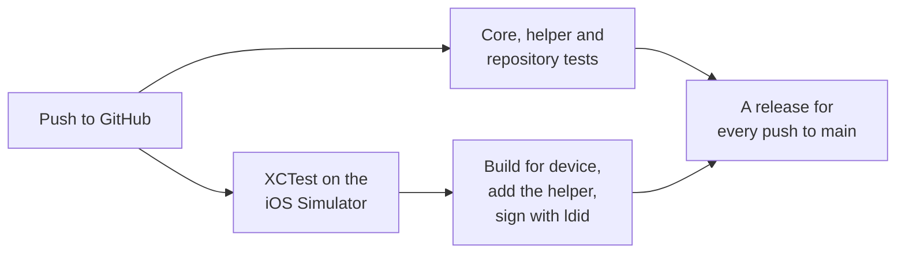

<p align="center">
  
</p>

<h1 align="center">Octopus</h1>

<p align="center">
  <b>Bringing your iPhone's files to Windows File Explorer, over USB, with no drivers.</b><br>
  Octopus serves a filesystem over MTP, the portable-device protocol Windows already supports for cameras and phones.
</p>

<p align="center">
  <a href="https://github.com/m9z2w4d8vw-blip/octopus/actions/workflows/build.yml"></a>
  <a href="https://github.com/m9z2w4d8vw-blip/octopus/releases/latest"></a>
  
  
  
</p>

<p align="center">
  <a href="#install"><b>Install</b></a> &nbsp;·&nbsp;
  <a href="#using-octopus"><b>Using Octopus</b></a> &nbsp;·&nbsp;
  <a href="#troubleshooting"><b>Troubleshooting</b></a> &nbsp;·&nbsp;
  <a href="#how-it-works"><b>How it works</b></a> &nbsp;·&nbsp;
  <a href="#building-and-testing"><b>Building</b></a>
</p>

---

Windows browses a camera or an Android phone in File Explorer without installing anything, because it already speaks
PTP and its extension MTP, the portable-device protocols. The iPhone speaks PTP too, but only to hand over photos.
Octopus gives it the rest of that role: a file-object provider and an MTP responder that serve an organised filesystem,
with browsing, downloads, uploads, renaming and deletion where permitted.

**Status:** the app, the file-object provider and the PTP/MTP responder (20 operations) are built and tested, and
updates install from the app. **There is no live USB transport yet, so Windows can't see Octopus in this build.** The
app says so rather than pretending otherwise. Serving this storage over the iPhone's real USB connection is the next
milestone (see [Known limitations](#known-limitations)).

> [!WARNING]
> Octopus is experimental and in development. Today it serves only files it generates itself: nothing from the
> iPhone's own filesystem is exposed. Its root helper runs only to install Octopus updates through TrollStore.

## Install

1. Install **`Octopus.tipa`** from the [latest release](https://github.com/m9z2w4d8vw-blip/octopus/releases/latest)
   with TrollStore.
2. Open Octopus. Later releases install from the app: see [Updates](#updates).

Coming from 0.1? It has no updater, so install 0.2 by hand once, as in step 1. To remove Octopus, delete it in
TrollStore.

## Requirements

| | |
| --- | --- |
| **iPhone** | iOS 17 or later. Developed on an iPhone 13. |
| **Installer** | TrollStore. Updates use its installer, so Octopus must be installed with it. |
| **Computer** | A Windows PC. Windows supports MTP devices without extra software, but it can't reach Octopus yet: see Status above. |

<details>
<summary><b>What TrollStore grants Octopus, and why</b></summary>

<br>

TrollStore keeps the entitlements a build is signed with. `tools/package.sh` signs these with `ldid`:

| Binary | Entitlements | Why |
| --- | --- | --- |
| `Octopus` | `com.apple.private.persona-mgmt` | Starts the update helper as root, through TrollStore's persona spawn |
| `Octopus` | `com.apple.private.security.no-sandbox` | Saves a downloaded update where the helper takes it, and starts the helper |
| `Octopus` | `platform-application` | Alongside the two above, as in Caz and Speaka |
| `octopushelper` | `platform-application`, `com.apple.private.security.no-sandbox`, `com.apple.private.security.container-required` (false) | Runs outside any sandbox or container |
| `octopushelper` | `com.apple.private.security.storage.AppBundles`, `com.apple.private.security.storage.AppDataContainers` | Reads TrollStore's bundle container to find its installer |
| `octopushelper` | `com.apple.private.persona-mgmt` | The same set as Speaka's and Caz's helpers |

If Octopus can't start the helper as root, **Update** falls back to TrollStore's install link, or to the releases page
without TrollStore.

</details>

## Using Octopus

### The app

- **Enable USB Access** opens into the activity sheet: it builds the storage, starts the responder, runs the protocol
  self-test (optional), reports that this build has no USB transport, and stops at *Ready*. The button then reads
  **Disable USB Access**, which releases everything.
- **The header** reads *by Parv*, or, when something needs you, says what in the warning colour: after Enable USB
  Access, that this build has no USB transport yet.
- **USB Connection** shows the service state, the transport and session, which states this build can reach, and the
  responder's counters.
- **Filesystem** shows the storage, the object tree and, for each object, its metadata and contents, read through the
  provider.
- **Activity** shows the operation log. **Run Self-Test** replays a recorded PTP/MTP session through the responder and
  checks every reply.
- **Settings** has haptics, self-test while enabling, the writable Scratch folder, **Update notifications** and
  **Check for Updates**, the versions, Dopamine's license and a link to this repository.
- **Update Available** appears above the button when a newer release is out; see [Updates](#updates).

### Updates

When a newer release is out, **Update Available** appears above the button. Tapping it shows the changelog, the notes
of every release newer than yours, newest first, and **Update** downloads `Octopus.tipa` and installs it: Octopus's
root helper hands it to TrollStore's installer, which closes Octopus when it's done. If the helper can't install it,
Octopus says why and asks TrollStore to install the same release from its link; without TrollStore, the releases page
opens. **Check for Updates** in Settings checks at once and opens the update if there is one. The line under it says
whether Octopus is up to date, why a check failed, or when Octopus last checked.

With **Update notifications** on, a notification says when a release is ready, and tapping it opens the update.
Octopus checks every 2 minutes while it's open, each time it comes to the front, and in the background when iOS lets
it, which needs Background App Refresh and can be hours apart. Each release is announced once, and only while iOS
allows Octopus's notifications; turned off in iOS Settings, the switch turns off too. Checks ask GitHub conditionally,
so an unchanged release list doesn't count against its limit of 60 checks an hour.

Each release's notes are its push's commit messages, so they read as the changelog; see
[Building and testing](#building-and-testing).

### The storage

```text
Octopus                (storage 0x00010001)
├── README.txt
├── Documents
│   ├── example.txt
│   └── sample.bin     4096 bytes of a fixed pattern
└── Information
    └── version.txt
```

Every object is generated in memory, and nothing from the iPhone's own filesystem is exposed. All of them are
read-only, and the storage says so. With **Writable Scratch folder** in Settings, an empty `Scratch` folder is added:
the only place a host may create, rename or delete objects. A second backend serves a real directory, for the tests
and as the start of a real filesystem backend. It refuses any directory without an `.octopus-disposable` marker file,
and never follows links out of it.

## Troubleshooting

| Symptom | Likely cause | What to do |
| --- | --- | --- |
| Windows doesn't list the iPhone | This build has no USB transport | Nothing yet: the header says so, and it's the next milestone. |
| Enable USB Access ends in *Error* | A step failed; the header keeps the reason | Open **Activity** for the failing step, then Disable and Enable again. |
| Run Self-Test reports a failure | A reply differed from the recorded session | Note the failing exchange in **Activity** and open an issue with it. |
| **Update Available** never appears | Octopus checks at launch and whenever it comes to the front; it was offline, or GitHub's limit of 60 checks an hour was reached | **Check for Updates** in Settings says why, or install from the [latest release](https://github.com/m9z2w4d8vw-blip/octopus/releases/latest). |
| *TrollStore's installer wasn't found* | Octopus wasn't installed with TrollStore, or TrollStore was removed | Octopus asks TrollStore to install from its link instead. Otherwise install TrollStore again, then Octopus. |
| *The update helper isn't running as root* | Octopus wasn't installed with TrollStore | Install Octopus with TrollStore. |
| *This iPhone can't start the update helper as root* | TrollStore's persona spawn isn't available | Install Octopus with TrollStore; until then, update from the latest release. |
| *The downloaded update wasn't found* | The download couldn't be saved where the helper takes it | Free some space and tap **Update** again. |
| No update notifications | Notifications aren't allowed, Background App Refresh is off, Low Power Mode is on, or Octopus was swiped away | Allow notifications and Background App Refresh for Octopus. It also checks whenever you open it. |

## Logs

**Activity** keeps the operation log: each step of enabling and disabling, the self-test's exchanges, and errors with
their reasons. When an update fails, the update window shows the helper's reason.

<details>
<summary><b>The update helper's messages and exit codes</b></summary>

<br>

`octopushelper` prints one line per event: `LOG` or `ERR`, a tab, then the text. Octopus shows the last `ERR` line
when an update fails.

| Code | Meaning |
| --- | --- |
| `0` | Installed. TrollStore's installer usually closes Octopus before this arrives |
| `2` | Usage: an unknown command or option, or nothing to install |
| `3` | The helper isn't running as root |
| `4` | The download is missing, isn't a regular `.tipa` or `.ipa`, or isn't directly inside `/var/mobile/Library/Caches/Octopus` or `/var/tmp/Octopus` |
| `5` | TrollStore's installer wasn't found |
| `6` | TrollStore's installer couldn't be started |
| `7` | TrollStore's installer failed; its own code is in the message |
| `-1` | Octopus couldn't start the helper |
| `-2` | The helper was killed |

</details>

## How it works

1. **Enable USB Access:** the app starts the C core, which builds the storage, starts the responder and, optionally,
   replays a recorded session through it as a self-test. Without a transport, the service stops at *Ready*.
2. **The provider:** each object has a handle that is never reused, so handles stay stable between enumerations.
   Folders are listed on first use, from pluggable backends (in memory, or a disposable directory), and a write policy
   is checked at every operation.
3. **The responder:** it parses PTP/MTP containers with bounds checks and answers 20 operations, from GetDeviceInfo to
   GetObjectPropList, with ten object properties. Malformed input is answered with an error and never read out of
   bounds, an OpenSession during a session keeps it and follows the host's numbering, and data phases are buffered up
   to 32 MiB.
4. **The transport, next:** the research behind Octopus recommends extending the iPhone's own PTP responder (`ptpd`)
   with a new storage provider, through a root helper, rather than replacing it.
5. **Updates:** the app reads GitHub's release list, downloads the newest `Octopus.tipa` and starts `octopushelper` as
   root through TrollStore's persona spawn. The helper accepts only a regular file directly inside Octopus's two
   download folders, finds TrollStore's installer through the metadata of its bundle container, runs
   `trollstorehelper install` in its own session, so the install finishes after Octopus closes, and deletes the
   download.

The core is C so it can be verified without Xcode, and so the same code can later link into a `ptpd` extension or a
root helper.

## Repository layout

```text
.
├── Octopus/
│   ├── App/                   the SwiftUI app, in Caz's design on the Slate backdrop
│   │   ├── MainScreen.swift       the header, the menu, the button and Update Available
│   │   ├── Windows.swift          USB Connection, Filesystem, Activity and Settings
│   │   ├── ActivitySheet.swift    the sheet the button opens into
│   │   ├── ServiceController.swift    the Swift bridge to the C core, and the service's states
│   │   ├── Updater.swift          checking GitHub, downloading, installing through the helper
│   │   ├── UpdateViews.swift      Update Available, the changelog and the download circle
│   │   ├── UpdateNotifications.swift    Update notifications and the background check
│   │   ├── Backdrop.swift, Theme.swift    the Slate backdrop; colours, geometry and motion
│   │   └── Spawn/                 starting the helper as root (C, imported by Swift as OctopusSpawn)
│   ├── Core/                  the file-object provider, its backends and the service (C11)
│   ├── Protocol/              PTP/MTP containers, datasets, properties and the responder (C11)
│   ├── RootHelper/            octopushelper, which installs updates with TrollStore (C)
│   ├── Resources/             Fonarto and its license, the asset catalog, Dopamine's license
│   ├── Tests/
│   │   ├── CoreTests/             C tests, the recorded transcript, the fuzzer
│   │   ├── HelperTests/           the helper and the spawn bridge, compiled on the host
│   │   ├── RepoTests/             this README, the changelog and the update path's shared values
│   │   └── AppTests/              XCTest: the bridge, the controller, the layout and the updater
│   ├── Octopus.entitlements   what TrollStore grants the app
│   └── module.modulemap       exposes the core (OctopusCore) and the spawn bridge (OctopusSpawn) to Swift
├── docs/                      CHANGELOG.md (every release), images/
├── tools/                     release_version.sh (the version a build publishes), package.sh (signing, the .tipa)
├── Makefile, project.yml      the native build and tests; the XcodeGen project (the .xcodeproj isn't committed)
└── .github/workflows/         CI: test, build, package, publish
```

`make test` fails, with an explanation, in any of these cases:

- a README link or `#` anchor breaks, or this tree names a file that doesn't exist;
- `docs/CHANGELOG.md` has no entry for `project.yml`'s `MARKETING_VERSION`;
- the updater's download folders differ from the helper's, its background task isn't permitted in Info.plist, or the
  updater, Settings and this README name different repositories;
- the entitlements the update path needs are missing, or `tools/package.sh` doesn't sign with them.

## Building and testing



Every push runs `.github/workflows/build.yml`. On Linux it runs the core's tests, the update helper's and the
repository's, all again under the sanitizers, then 300,000 fuzzing iterations and GCC's static analyzer. On macOS it
runs the tests and sanitizers again with Apple Clang, runs XCTest on an iOS Simulator and builds for device, and
`tools/package.sh` adds the helper, signs both with `ldid` and zips the app. Each push to `main` that passes publishes
a release named after its version (`project.yml`'s `MARKETING_VERSION` plus the run number, so `0.2.42`) with
`Octopus.tipa`, `Octopus.ipa` and `SHA256SUMS`. Its notes are the push's commit messages, which the app shows as the
changelog, so write each commit's first line for the people who use Octopus. A pushed tag like `v0.3.0` publishes
that version. Publishing is retried, since GitHub's services sometimes fail partway.

<details>
<summary><b>Building locally, and what the tests cover</b></summary>

<br>

The core, the helper and the repository checks need GCC or Clang and Python 3:

```sh
make test       # the core's tests and transcript replay, the helper and spawn tests, the repository checks
make sanitize   # the core's and the helper's tests under ASan, UBSan and LeakSanitizer
make fuzz       # randomised and mutated PTP/MTP input against the responder
make analyze    # GCC's static analyzer over the core, the update helper and the spawn bridge
```

The app needs macOS with Xcode, plus XcodeGen and ldid (`brew install xcodegen ldid`):

```sh
xcodegen generate
xcodebuild build -project Octopus.xcodeproj -scheme Octopus -configuration Release \
  -destination 'generic/platform=iOS' -derivedDataPath build/DerivedData \
  CODE_SIGNING_ALLOWED=NO CODE_SIGNING_REQUIRED=NO CODE_SIGN_IDENTITY=""
bash tools/package.sh   # build/Octopus.tipa and build/Octopus.ipa
```

- **The core:** 1,671 checks pass, also under the sanitizers; 300,000 fuzzing iterations run without faults;
  the analyzer reports nothing. A 22-exchange enumeration session replays byte for byte against an encoder written
  separately from the PIMA 15740 and MTP 1.0 layouts. The session follows the documented MTP flow; it isn't a capture
  from Windows.
- **The update path:** the helper is built in a test mode that starts nothing and puts every device path under a
  temporary folder, then run through each exit code and the rules for which files it takes. The spawn bridge is
  built as is and checked for its output, exit codes, signals, output cap and environment.
- **The app:** XCTest covers the bridge to the core, the controller's states, the layout and the updater's choices.
  The Swift is compiled only in CI.

</details>

## Safety and recovery

> [!CAUTION]
> If an update goes wrong, recover in this order:
>
> 1. Open Octopus again. Whichever version opens is the one installed, and **Check for Updates** tries again.
> 2. Install `Octopus.tipa` from the [latest release](https://github.com/m9z2w4d8vw-blip/octopus/releases/latest)
>    with TrollStore.
> 3. Delete Octopus in TrollStore, then install it again.

The root helper does one thing: it hands TrollStore's installer a `.tipa` or `.ipa` that is a regular file directly
inside Octopus's own download folders, then deletes it. The storage Octopus serves is generated in memory, and the
directory backend refuses any directory without its marker file.

## Known limitations

- **No USB transport yet.** Windows can't see Octopus in this build. Next: serve this storage over the iPhone's real
  USB PTP function and record the exact requests Windows sends, which then become a replay fixture for the responder.
- **Generated files only.** Nothing from the iPhone's own filesystem is served yet.
- **Transfers up to 32 MiB.** Data phases are buffered; larger files need streaming.
- **No events.** The responder sends none, so a host isn't told about changes made on the iPhone.
- **Not observed with Windows.** Explorer's compatibility hasn't been seen on hardware.
- **Updates need TrollStore, and background checks run when iOS chooses.** There's no always-running checker like
  Speaka's, which comes with its tweak.
- **0.1 can't update itself.** Install 0.2 by hand once.

## Changelog

Every release, newest first, is in [docs/CHANGELOG.md](docs/CHANGELOG.md).

## Credits

- The interface follows [**Caz**](https://github.com/m9z2w4d8vw-blip/Caz)'s specification: its layout, panels,
  typography, springs and haptics. The Slate backdrop is a recoloured reconstruction of Caz's Sunshine Sweep.
- The updater and its screens are [**Speaka**](https://github.com/m9z2w4d8vw-blip/Speaka)'s, which are Caz's, adapted
  from [**Dopamine**](https://github.com/opa334/Dopamine) by Lars Fröder (opa334) and its contributors under the MIT
  License. The license ships in the app under **Settings > Dopamine's license**.
- The wordmark is live text in [Fonarto](https://www.fontspace.com/fonarto-2-font-f104632) Regular by Locomotype,
  freeware for personal and commercial use. The font ships in the app with its
  [license](Octopus/Resources/Fonts/Fonarto-License.txt).
- Updates install through [**TrollStore**](https://github.com/opa334/TrollStore)'s installer. The app is built with
  [**XcodeGen**](https://github.com/yonaskolb/XcodeGen) and signed with [**ldid**](https://github.com/ProcursusTeam/ldid).
